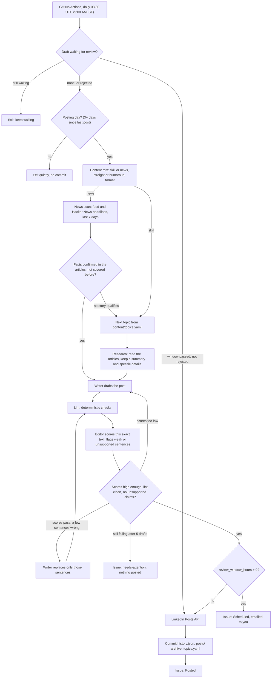

# LinkedIn AI Series Agent

A small Python agent that researches, writes, quality-checks and publishes a LinkedIn post
every 3 days on AI and the future of tech. It runs on GitHub Actions with no manual step, posts
through LinkedIn's official API, and keeps a full record of everything it publishes. It runs on
open models through Amazon Bedrock for a few cents a month, and also supports free model tiers
(Gemini, Groq) and Claude.

The hard part isn't calling an API. It's getting posts that read like a person wrote them, with
facts that hold up, every time, unattended. Most of this repo is about that: research grounded
in real articles, a second "editor" model, deterministic checks that reject AI-sounding text,
targeted fixes instead of blind rewrites, and clear alerts when something needs a human.

## What it does

Every day at 03:30 UTC (9:00 AM IST) a GitHub Actions run:

1. Publishes a draft that has finished its review window, unless you rejected it (see
   [Review before posting](#review-before-posting)).
2. Checks whether it's a posting day (3+ days since the last post).
3. Picks the post type and tone: about 1 in 3 posts reacts to recent news, about 1 in 3 is
   dry or funny, never two of either in a row, and the format rotates so consecutive posts
   never share a shape.
4. Researches from free sources (RSS feeds of company blogs and tech press, plus Hacker News
   search): 1-2 recent developments for a skill topic, or one news story from the last 7 days.
   It fetches the articles, and the model works only from their text: a short summary plus up to
   4 specific details per article, each cited by id. News needs 2 independent sources or 1
   official one, and every key fact is checked against the article text.
5. Writes the post and checks it three ways: deterministic lint, a separate "blunt editor"
   model that scores it, and a list of every sentence where the author claims to have done or
   seen something, which the editor must check against the author facts. If the scores pass but
   a few sentences break a rule, only those sentences are rewritten. Otherwise the writer
   redrafts with the feedback: up to 5 full drafts, plus up to 2 sentence-fix rounds.
6. Posts only text that the editor scored and lint passed. By default it first emails you the
   draft as a GitHub issue and publishes it on the next day's run, unless you reject it.
7. Publishes through the LinkedIn Posts API, commits the updated history back to the repo, and
   opens a GitHub issue with the post, link, scores and sources.

If anything goes wrong it doesn't post. It opens a `needs-attention` issue instead, GitHub emails
you, and the next day's run tries again.

## How it works



| Module | Job |
|---|---|
| `scheduler.py` | Is today a posting day? (date interval, so month boundaries just work) |
| `mix.py` | Post type, tone and format rotation |
| `topics.py` | Next topic; asks the model for 5 new ones when fewer than 3 are left, so the series never runs dry |
| `sources.py` | Free research sources: RSS/Atom feeds, Hacker News search, article text extraction |
| `research.py`, `news.py` | Pick developments and news from fetched articles, with specific details; news is scored, de-duplicated and fact-checked |
| `llm.py` | One interface over OpenAI-compatible endpoints (Bedrock open models, Gemini, Groq) and Claude (direct or on Bedrock): retries, overload fallback, JSON mode |
| `writer.py` | Writer pass, full redrafts and sentence-level fixes |
| `editor.py` | Editor pass: scores, flagged sentences, the personal-claims check |
| `generate.py` | The draft, lint, edit and fix loop |
| `lint.py` | Deterministic anti-AI checks (banned phrases, em dashes, "it's not X, it's Y", repeated openings, emoji, hashtags, length) |
| `linkedin.py` | LinkedIn Posts API client: escaping, retries, 401 handling |
| `notify.py` | GitHub issues: posted records, alerts, token reminders, review-window drafts |
| `series.py`, `templates.py` | Load `content/series.yaml` and fill it, with each call's values, into the prompts |
| `main.py` | Orchestration and the command line |

Prompts live in `src/agent/prompts/` as Markdown, not inline strings. Who the series is by and
what it's about live in `content/series.yaml`, the writing rules in `content/style.md`, the only
personal facts the agent may use in `content/author.md`, and the research sources in
`content/feeds.yaml`. So the same agent can run a series for anyone, on any subject: see
[Run your own series](#run-your-own-series).

## Why the posts shouldn't read like AI

- **A style guide with teeth.** `content/style.md` sets the voice (plain, first person, real
  opinions, specific examples) and lists banned words and patterns.
- **Deterministic lint** (`lint.py`) rejects any post with a banned phrase, more than one em
  dash, "it's not X, it's Y" constructions, three sentences in a row starting with the same
  word, repeated lists of three, emoji bullets, more than one emoji or three hashtags, numbered
  "part N of M" posts, or an opening line shaped like one of the last 5 posts.
- **A second model as editor.** It scores "sounds like a real person" (needs 8/10), and for
  humorous posts "actually funny and still professional" (needs 7/10). It gets the lint results
  and today's date, so it doesn't count words or guess at dates, and it quotes every line that
  sounds generic or isn't backed by the research or author facts.
- **No invented stories.** Code picks out every sentence where the author seems to say he did,
  saw or made something ("I made an order yesterday", "we've spent the last year") and the
  editor must check each one against `content/author.md`. Mini stories have to open as plainly
  hypothetical ("Picture a retailer whose...").
- **Facts only from this run's articles.** The model sees only articles fetched in this run and
  cites them by id; the agent maps ids back to real URLs and feed dates, so a post can't cite a
  made-up source. Specifics about companies and products must come from the listed details.
- **Fix the sentence, not the post.** When a draft is nearly there, only the flagged sentences
  are replaced, and code splices them in, so the rest of the post can't pick up new problems.
- **Only checked text is posted.** The post that goes out is always the exact text the editor
  scored and lint passed.

## Setup

You need a GitHub account, a LinkedIn account, and an API key from a model provider. About 45
minutes in total; only step 4 needs anything installed on your computer.

### 1. Get the code

Fork or clone this repository. Everything below happens in your copy.

### 2. Model provider

The repo is set up for **open models on Amazon Bedrock**: DeepSeek V3.2 writes and researches,
and Mistral Large 3 edits. They cost a few cents a month and were the most reliable combination
in testing. Other providers are a config change away.

| `llm_provider` | Key secret | Models | Cost |
|---|---|---|---|
| `bedrock-openai` (current) | `AWS_BEARER_TOKEN_BEDROCK` | Open models on Bedrock (DeepSeek, Mistral, Kimi, Qwen, ...) through its OpenAI-compatible endpoint | A few cents a month |
| `anthropic` | `ANTHROPIC_API_KEY` | Claude, direct from Anthropic | About $1-3 a month; prepaid credit caps it |
| `bedrock` | `AWS_BEARER_TOKEN_BEDROCK` | Claude on Bedrock | About $1-3 a month |
| `gemini` | `GEMINI_API_KEY` | Gemini | Free tier, rate-limited |
| `groq` | `GROQ_API_KEY` | Open models on Groq | Free tier, tight rate limits |

#### Open models on Amazon Bedrock (the current setup)

1. Create an AWS account, ideally a personal one, since the bot posts to your own profile. New
   accounts get AWS credits; check **Billing > Bills** after the first week to see whether
   these models are covered.
2. In **AWS Budgets**, add a small monthly budget alert (say $5), so a bug can never run up a
   bill unnoticed.
3. In the Amazon Bedrock console (region **us-east-1**), create a **long-term API key** with an
   expiry date. Short-term keys last hours, which is too short for a daily job. Put a calendar
   reminder a few days before the expiry: nothing in the agent warns you about this key.
4. Save the key as the `AWS_BEARER_TOKEN_BEDROCK` repository secret (step 5).
5. `config.yaml` already has:

   ```yaml
   llm_provider: bedrock-openai
   writer_model: deepseek.v3.2
   editor_model: mistral.mistral-large-3-675b-instruct
   research_model: deepseek.v3.2
   fallback_model: mistral.mistral-large-3-675b-instruct
   llm_base_url: https://bedrock-mantle.us-east-1.api.aws/v1
   llm_api_key_env: AWS_BEARER_TOKEN_BEDROCK
   ```

6. Run the workflow with **check** ticked (step 6). It lists every model your key can use, so
   you can swap any of the four model names for another one from that list.

What we learned picking models: the writer must reliably follow "never write X" rules, and the
editor must be strict about facts but not invent problems. Kimi K2.5 kept writing banned
"isn't X. It's Y" lines; DeepSeek V3.2 as editor got word counts wrong and missed invented
stories; Kimi K2 Thinking spent its whole output budget thinking before it reviewed anything.
Mistral Large 3 was the most accurate editor. A different model as editor than as writer also avoids a model going
easy on its own text.

#### Claude (direct, or on Bedrock)

Claude follows the style rules and writes dry humour noticeably better than the open models, so
more posting days pass on the first or second draft.

- **Direct** (`anthropic`): create a key at platform.claude.com, add $5 of prepaid credit (with
  auto-reload off it can never charge more), save it as `ANTHROPIC_API_KEY`, and set
  `llm_provider: anthropic` with all three models set to `claude-sonnet-5-5`, and
  `llm_base_url` and `llm_api_key_env` set to `""`.
- **On Bedrock** (`bedrock`): first submit Anthropic's one-time **use case details** form in the
  Bedrock model catalog. Some new AWS accounts get "Your account is not authorized to perform
  this action" there; only AWS support can lift that (**Support Center > Create case > Account
  and billing**). Then set `llm_provider: bedrock`, the three models to
  `anthropic.claude-sonnet-5-5`, `fallback_model: anthropic.claude-sonnet-5` and `aws_region`.

### 3. LinkedIn developer app

1. Go to [linkedin.com/developers/apps/new](https://www.linkedin.com/developers/apps/new).
   - **App name**: anything, e.g. "LinkedIn AI Series Agent".
   - **LinkedIn Page**: required, but it only owns the app; posts go to your personal profile.
     Use a page you admin; if you have none, create a small one at
     [linkedin.com/company/setup/new](https://www.linkedin.com/company/setup/new/). Avoid your
     employer's page.
   - **App logo**: any square image. Accept the terms and create the app.
2. If LinkedIn asks to **verify** the app, go to the **Settings** tab, click **Verify**, generate
   the URL and open it while logged in as the page admin.
3. On the **Products** tab, request **Sign In with LinkedIn using OpenID Connect** and **Share on
   LinkedIn**. Both are self-serve and show "Added" straight away.
4. On the **Auth** tab:
   - copy the **Client ID** and **Primary Client Secret**;
   - under **Authorized redirect URLs**, add exactly `http://localhost:8000/callback` (`http`,
     no trailing slash);
   - check that the OAuth scopes include `openid`, `profile` and `w_member_social`.

### 4. Get a LinkedIn token (on your own computer)

This is the only step that needs Python on your machine (3.12 or newer), because it opens your
browser and listens on `localhost:8000`.

macOS or Linux:

```bash
python -m venv .venv && .venv/bin/pip install -e .
.venv/bin/python scripts/linkedin_auth.py
```

Windows: install Python with `winget install Python.Python.3.12` (or from python.org, ticking
"Add python.exe to PATH"), then in PowerShell from the repository folder (the leading `.\`
matters):

```powershell
git pull
py -3.12 -m venv .venv
.\.venv\Scripts\python -m pip install -e .
.\.venv\Scripts\python scripts\linkedin_auth.py
```

The script asks for the Client ID and Secret (or reads `LINKEDIN_CLIENT_ID` /
`LINKEDIN_CLIENT_SECRET` from `.env`; the secret isn't shown as you paste it), opens LinkedIn's
consent page, and after you click **Allow** prints:

```
LINKEDIN_ACCESS_TOKEN      AQV...
LINKEDIN_PERSON_URN        urn:li:person:AbC123
LINKEDIN_TOKEN_EXPIRES_ON  2026-12-31
```

Sign in with the account you want to post from. If Windows Firewall asks whether Python may use
the network, allow it on private networks. Treat the token like a password: don't paste it into
chat, email or a file.

| Error | Fix |
|---|---|
| `redirect_uri does not match` | The redirect URL in step 3 must be exactly `http://localhost:8000/callback` |
| `unauthorized_scope_error` | A product from step 3 is missing |
| Port 8000 already in use | Close whatever uses it and run the script again |

### 5. GitHub secrets, variables and settings

In your repository: **Settings > Secrets and variables > Actions**.

| Name | Kind | Value |
|---|---|---|
| `AWS_BEARER_TOKEN_BEDROCK` | Secret | Your Bedrock API key (or the key for your provider: `ANTHROPIC_API_KEY`, `GEMINI_API_KEY`, `GROQ_API_KEY`) |
| `LINKEDIN_ACCESS_TOKEN` | Secret | From `linkedin_auth.py` |
| `LINKEDIN_PERSON_URN` | Secret | From `linkedin_auth.py`, like `urn:li:person:AbC123` |
| `LINKEDIN_TOKEN_EXPIRES_ON` | Variable | From `linkedin_auth.py`, like `2026-12-31` |

Then:

- **Settings > Actions > General > Workflow permissions**: choose **Read and write
  permissions**. The agent commits its history after every post.
- **Watch > Custom > Issues** at the top of the repository, and make sure email is on under your
  GitHub **Settings > Notifications**. Every draft, post and alert arrives as an issue, so this
  is how they reach your inbox.

The workflow uses the built-in `GITHUB_TOKEN` for commits and issues; there's nothing to add for
that.

### 6. Check the setup and preview posts

Everything here runs from the browser: **Actions > Post to LinkedIn > Run workflow**.

1. Tick only **check** and run it. The log confirms the API key works, lists the models your key
   can use, flags any model name that doesn't exist, and shows which research feeds load. It
   ends with `All good.` It doesn't test LinkedIn; the first real post does.
2. Tick **dry_run** and **force**, pick a **post_type** and **tone**, and run it. The log shows
   the post, the articles and details it used, editor scores and lint results for every
   attempt. Lines like `generate.attempt ... kind=draft` and `kind=fix` show each round, and
   `writer.fix edits=2 applied=2` shows a sentence fix. A dry run never posts, opens issues,
   commits, or changes `state/`, `content/` or `posts/`. Try all four kinds: skill or news,
   straight or humorous.

The same from a local checkout, with the key in `.env`:

```bash
.venv/bin/python -m agent.main --check
.venv/bin/python -m agent.main --dry-run --force --post-type news --tone humorous
```

### 7. Go live

1. **Close leftovers.** Before LinkedIn was set up, the daily run had nothing to post with and
   may have opened `needs-attention` issues. Close them.
2. **Choose how much control you want.** `review_window_hours: 20` (the current setting) emails
   you each draft and posts it on the next day's run unless you reject it. `0` posts straight
   away. See [Review before posting](#review-before-posting).
3. **First post.** **Actions > Post to LinkedIn > Run workflow** on `main` with only **force**
   ticked (`post_type` and `tone` on `auto`). It takes 2-4 minutes. With the review window on
   you get a **Scheduled** issue, and the post goes out on the first run after the 20 hours: the
   next 9:00 AM IST run if it's that late, or run the workflow by hand (nothing ticked) once the
   window has passed. Set `review_window_hours: 0` for this one run if you want to see it
   publish straight away. If the
   run ends with a `needs-attention` issue, the quality checks failed and nothing was posted:
   run it again.
4. **Check it.** On LinkedIn (your profile > Activity > Posts): the text and line breaks look
   right, hashtags are clickable, there are no stray `\` before brackets or `@`, and a link (if
   any) has a preview. On GitHub: a **Posted:** issue labelled `posted`, and a
   `chore: post <slug>` commit on `main` that updates `state/history.json`,
   `content/topics.yaml` and adds a file to `posts/`. Run `git pull` before working locally.
5. **Calendar reminders**: about 50 days out for the LinkedIn token, and a few days before your
   Bedrock key expires.

After that the daily schedule takes over. The [go-live checklist](#go-live-checklist) has the
same steps as tick boxes.

## Day to day

### What happens on its own

- The workflow runs daily at 9:00 AM IST. GitHub sometimes starts scheduled runs 10-60 minutes
  late.
- It posts when 3 or more days have passed since the last post. Other days finish quietly in
  about a minute.
- On a day when the quality checks fail, nothing is posted, you get a `needs-attention` issue
  with the best draft and the reasons, and the next day's run tries again. With open models
  this happens now and then, so the gap between posts is sometimes 4-5 days instead of 3.

### Review before posting

With `review_window_hours` above 0 (currently `20`), each finished post waits as a GitHub issue
called **Scheduled: \<topic\> (\<date\>)**, labelled `scheduled`, and GitHub emails it to you.

- **Do nothing** and the first run after the window publishes it, comments the LinkedIn link on
  the issue and closes it.
- **Close the issue or add the `reject` label** and it isn't posted; the next run writes a
  fresh draft, which arrives as a new email.
- You can approve or reject, but not edit: the agent publishes the version it checked.
- While a draft waits, real runs (even forced ones) only wait for it. Dry runs aren't affected.
- A draft made in the evening isn't ready by the next 9:00 AM run, so it goes out the morning
  after; or run the workflow by hand (nothing ticked) once the window has passed.

Use 20 rather than 24 hours: daily runs don't start at the same minute every day, and with 24 a
run that starts a few minutes early would hold the post for another full day. Set it to `0` for
fully automatic posting once you trust the posts.

### Changing things

- **Who and what the series is about.** `content/series.yaml`; see
  [Run your own series](#run-your-own-series).
- **Topics.** Append to `content/topics.yaml` with a unique `id`, a `title`, an `angle` and
  `status: pending`. Topics are used in file order. The agent adds its own (marked
  `source: auto`) when fewer than 3 are pending; set `auto_extend_topics: false` to stop that.
- **Research sources.** Edit `content/feeds.yaml`: add RSS feeds you trust (mark company blogs
  `official: true`), remove ones that go quiet, or change the Hacker News queries. The **check**
  run shows which feeds load.
- **Tone and mix.** In `config.yaml`: `news_post_ratio` and `humour_ratio` (default 0.33 each; 0
  turns them off), `post_interval_days`, `min_editor_score`, `min_humour_score`, `max_attempts`.
  The voice itself is in `content/style.md`.
- **Models or provider.** In `config.yaml`, change `llm_provider` and the model names, and add
  that provider's key as a secret. Run **check** afterwards.
- **Run by hand.** **Actions > Post to LinkedIn > Run workflow**: `force` ignores the interval,
  `topic_id` picks a topic, `post_type` and `tone` override the mix, `dry_run` writes without
  publishing, `check` only checks the setup.
- **Pause.** **Actions > Post to LinkedIn > ... > Disable workflow**, and **Enable workflow** to
  resume. If GitHub ever emails that the scheduled workflow was disabled, re-enable it the same
  way.
- **A post you don't like.** Delete it on LinkedIn. Its `Posted:` issue has the scores and
  sources, which helps work out what to change.

### Renewals

| What | When | How |
|---|---|---|
| LinkedIn token | About every 60 days. A `token-expiry` issue opens 7 days before `LINKEDIN_TOKEN_EXPIRES_ON` (one issue, updated daily). | Re-run `scripts/linkedin_auth.py` and update the `LINKEDIN_ACCESS_TOKEN` secret and the `LINKEDIN_TOKEN_EXPIRES_ON` variable. The person URN doesn't change. |
| Bedrock API key | The expiry you chose. No reminder from the agent. | Create a new long-term key and replace the `AWS_BEARER_TOKEN_BEDROCK` secret. |

### Troubleshooting

| Symptom | Likely cause | Fix |
|---|---|---|
| `needs-attention`: LinkedIn returned 401 | Token expired or revoked | Renew the LinkedIn token (above) |
| `needs-attention`: LinkedIn returned 403 | The app lacks **Share on LinkedIn** | Add the product (setup step 3), then get a new token |
| `needs-attention`: LinkedIn settings missing | A LinkedIn secret isn't set | Setup step 5 |
| Model call 401 or 403 in the log | Model key expired or not allowed | Replace the key secret; run **check** |
| Model `NOT FOUND` in **check** | Model renamed or not offered to your key | Pick one from the `available models:` line |
| "Commit state" step fails | Workflow permissions | **Read and write permissions** (setup step 5) |
| Several quality failures in a row | The models are struggling with today's topic or format | Paste the run log into an issue; consider Claude |
| No emails | Not watching issues, or email notifications off | Setup step 5 |

## Run your own series

Nothing in the code is tied to this series. Everything about who writes it and what it covers
lives in five files under `content/`, so anyone can run their own series, on any subject
(farm tech, logistics, e-commerce, order management, ...), from a copy of this repository.

| File | What to put in it |
|---|---|
| `series.yaml` | Who writes the series and what it's about: name, a one-line summary of who they are, the theme, what each post should explain, the topic areas, what news counts and what a good take looks like. Each value drops into a sentence in the prompts; the comment above it shows which. |
| `author.md` | The only personal facts the agent may use: role, experience, work. Anything not here, the posts won't claim. |
| `topics.yaml` | The first topics, in order. The agent adds more inside the theme when fewer than 3 are left. |
| `feeds.yaml` | RSS feeds for the subject's news and blogs, the domains that count as official, Hacker News queries, and `generic_words`: words in almost every headline on the subject (for an AI series, "AI" and "tech"), which don't count as a match on their own. |
| `style.md` | Optional: the voice, banned phrases and humour rules. The defaults suit most professional posts. |

Then follow [Setup](#setup) with your own model key and LinkedIn token, run **check** (its first
line names the series it loaded), and preview a few dry runs before going live.

An example `series.yaml` for a different series:

```yaml
author:
  name: Priya Sharma
  first_name: Priya
  summary: an agronomist who advises smallholder farms on soil health and irrigation
  kind: agronomist
  voice: a practical agronomist talking to farmers at the co-op
  peers: agronomists and farm advisers
  own_work: soil testing and drip irrigation work
series:
  theme: practical farm tech
  writes_about: farming, soil and water
  skill_promise: why the practice matters this season and how it protects yields
  topic_areas: soil health, irrigation, crop planning, farm equipment
  learner: a farmer or farm adviser
  example_scenario: Say a farm switches to drip irrigation in March...
research:
  focus: a new crop variety, a government scheme, a field trial with results
  why_it_matters_for: farmers and farm advisers
news:
  focus: crop prices, monsoon forecasts, irrigation schemes, agri policy
  major: a major policy change or a failed monsoon
  take: what it means for small farms and whether the claims hold up
```

Every field is required. A missing, empty or misspelled field stops the run with a message
naming it. The tests check that a different `series.yaml` reaches every prompt and that nothing
from this series leaks into it.

## Issues it opens

| Label | When |
|---|---|
| `scheduled` | A finished draft waiting out the review window. Close it or label it `reject` to stop it. |
| `posted` | Every published post: text, LinkedIn link, type, tone, format, editor scores, sources |
| `needs-attention` | Quality checks failed on every draft and fix round (with the best draft and reasons), the model API or LinkedIn failed, or the topic backlog couldn't be refilled. Nothing was posted. |
| `token-expiry` | The LinkedIn token expires within 7 days |

## Costs

- **Model, open models on Bedrock (current):** a posting day makes roughly 5 to 25 model calls
  (research or news scan and verification, then up to 5 drafts and 2 sentence fixes, each
  reviewed by the editor), about 15-65 thousand input tokens and a few thousand output tokens.
  DeepSeek V3.2 is listed at about $0.62 per million input tokens and $1.85 per million output
  tokens, so expect a few cents per post and well under $1 a month. Prices for these models
  aren't in `config.yaml`, so the `est_cost_usd` in the run summary shows 0: check **AWS Billing
  > Bills** for the real figure. Charges under "Amazon Bedrock" can be covered by AWS credits;
  charges under "AWS Marketplace" go to your card.
- **Model, other providers:** $0 on the Gemini or Groq free tier. Claude (direct or on Bedrock)
  is very roughly $0.15-0.35 per post, $1-3 a month at Sonnet prices.
- **Research sources:** free. RSS feeds and the Hacker News search API need no keys.
- **LinkedIn API:** free.
- **GitHub Actions:** free for public repositories. Non-posting days finish in about a minute.

## Limitations

- **Open models pass less often than Claude.** With DeepSeek and Mistral, most posting days pass
  within the 5 drafts, but some don't; those days post nothing and retry the next day. Claude is
  a config change away if that gets annoying.
- **The editor is a model too.** It occasionally flags something that's fine or misses something
  that isn't. The deterministic lint, the personal-claims check and the "details only from the
  articles" rule are there to catch what it misses; the review window lets you catch the rest.
- **Providers change models.** A model can be renamed, retired or overloaded. The **check** run
  catches a missing model; an overloaded or missing one switches to `fallback_model` for the rest
  of the run. Free tiers also change their limits, and Google's terms let it use free-tier
  prompts to improve its products (the posts are public anyway).
- **Research is only as good as the feeds.** The agent sees what `content/feeds.yaml` and Hacker
  News surface. Feeds sometimes move or break (they're skipped, and **check** shows them).
  Paywalled or bot-blocked articles (OpenAI's site, for one) fall back to the feed summary.
- **Strict news verification means some news days become skill days.** That's on purpose.
- **Two credentials expire.** The LinkedIn token lasts about 60 days (the agent reminds you); the
  Bedrock key lasts as long as you chose (it doesn't).
- **Text-only posts in v1.** `linkedin.py` has a `media_urn` hook for images later.
- **Rare double-post risk.** If LinkedIn returns a 5xx after actually creating a post, the retry
  can create a second one. And if the state commit fails after a post goes out, the next run
  could post again. The workflow retries the push and flags an error if it still fails.
- **GitHub's cron isn't exact.** Scheduled runs can start late when GitHub is busy.

## Project layout

```
config.yaml                 interval, model provider and names, word limits, mix ratios, flags
content/
  series.yaml               who writes the series and what it's about (fills every prompt)
  topics.yaml               topic backlog
  feeds.yaml                research sources: RSS feeds, official domains, Hacker News queries
  style.md                  the writing style guide
  author.md                 the only personal facts the agent may use
state/history.json          every post: date, type, topic or news story, format, tone, text, URN, sources
posts/                      archive: YYYY-MM-DD-<slug>.md per published post
src/agent/                  the agent (modules above)
src/agent/prompts/          every prompt, as Markdown (writer, editor, fix_sentences, research, news, ...)
scripts/linkedin_auth.py    one-time local OAuth helper
tests/                      pytest; every model, feed, LinkedIn and GitHub call is mocked
.github/workflows/          post.yml (daily run) and tests.yml (lint + tests on every push)
```

## Development

```bash
pip install -e ".[dev]"
ruff check src tests scripts && ruff format --check src tests scripts
pytest -q
```

On Windows use `.\.venv\Scripts\python -m pip install -e ".[dev]"` and
`.\.venv\Scripts\python -m pytest -q`. The workflows install dependencies fresh on every run
(no pip cache: GitHub's cache service sometimes throttled downloads until the job timed out).

## Notes on API choices

These were checked against current documentation in October 2026. Where they differ from the
original brief in `CLAUDE.md`, that's noted and was agreed.

- **Model providers (change from the brief).** The brief specified the Claude API. To keep costs
  near zero, the agent talks to any OpenAI-compatible endpoint. It runs on open models through
  Amazon Bedrock's OpenAI-compatible endpoint (`bedrock-mantle`, authenticated with a Bedrock
  API key), and the same client covers Gemini's free tier
  (`https://generativelanguage.googleapis.com/v1beta/openai/`) and Groq. Claude is still
  supported through the official Anthropic SDK, directly (`anthropic`, with prompt caching and
  the server-side refusal fallback) or on Bedrock (`bedrock`, the SDK's `AnthropicBedrockMantle`
  client; a declined request is retried once on `fallback_model` because Bedrock has no
  server-side fallback). The **check** run lists models on OpenAI-compatible endpoints and tests
  Claude models with a free token count.
- **Research from free sources (change from the brief).** The brief specified Anthropic's
  server-side web search. That isn't free on other providers, so research comes from RSS feeds
  and Hacker News search, and the agent fetches the articles itself. This also makes sourcing
  stricter: the model can only cite articles the agent actually fetched, and up to 4 specific
  details per article are passed to the writer and editor so specifics come from the source.
- **Editor rewrites are never posted (change from the brief).** The brief has the editor return
  a rewritten version. Nothing checked that rewrite after it was written, and editors slipped
  invented stories and wrong facts into it. The editor still returns a rewrite (kept for
  reference), but the writer fixes the flagged problems, and only a version the editor scored
  and lint passed can be posted.
- **Up to 5 drafts plus 2 sentence fixes (change from the brief).** The brief allows 3 rounds.
  With open models, posts often came within one round of passing, so `max_attempts` is 5. On
  top of that, when a draft's scores pass but a few sentences break a rule (banned phrase,
  contrast setup, em dashes, repeated starts, lists of three, length, an unsupported claim),
  the writer returns find-and-replace edits for just those sentences, code applies them, and the
  result is scored and linted again, up to 2 times. A post that still fails isn't published.
- **The series is configurable.** Who writes it and what it covers were written into the prompts;
  they now come from `content/series.yaml`, so the agent can run anyone's series. With this
  series' values the prompts read as before, except that "he" and "his" became the author's name
  or "the author".
- **The editor sees code's results.** Lint runs before the editor, and the editor gets the exact
  word count and issues, today's date, the list of first-person experience sentences to check,
  every sentence with a number in it (each number must come from the research or the author
  facts, made-up scenarios included), and each research date counted from today in plain words
  ("4 days ago, earlier this week"). The writer gets the same date words, so posts don't say
  "last week" for something from Wednesday. The editor's notes that only say something is fine ("no factual problems found") are
  dropped so they can't fail a post.
- **JSON replies.** On OpenAI-compatible endpoints the agent asks for JSON mode
  (`response_format: json_object`), falling back to plain requests if an endpoint rejects it; the
  reply is parsed forgivingly (raw line breaks in strings allowed, and only an object with the
  required fields counts), with one retry. An editor reply that still can't be read fails that
  round, not the whole run. Claude uses native structured outputs.
- **LinkedIn API version.** The Posts API is called with `LinkedIn-Version: 202610`, the newest
  version as of October 2026; LinkedIn supports each version for at least a year.
- **LinkedIn text escaping.** Post text is escaped per LinkedIn's "little text format" (every
  one of `| { } @ [ ] ( ) < > # \ * _ ~` gets a backslash), and hashtags are sent as
  `{hashtag|\#|Tag}` templates so they still render as hashtags.

## Go-live checklist

- [ ] Model key saved as its secret (`AWS_BEARER_TOKEN_BEDROCK` for the current setup), with a
      calendar reminder before it expires, and an AWS budget alert set.
- [ ] **Run workflow** with **check** ticked: the log ends with `All good.`
- [ ] Dry runs read well for all four kinds of post (pick them with **post_type** and **tone**):
      straight skill, humorous skill, straight news, humorous news. If the voice is off, edit
      `content/style.md`, not the code.
- [ ] **Actions > Tests** is green on the latest commit.
- [ ] LinkedIn app created, verified if asked, with both products and the
      `http://localhost:8000/callback` redirect.
- [ ] `scripts/linkedin_auth.py` run; `LINKEDIN_ACCESS_TOKEN` and `LINKEDIN_PERSON_URN` saved as
      secrets, `LINKEDIN_TOKEN_EXPIRES_ON` saved as a variable.
- [ ] **Settings > Actions > General > Workflow permissions** set to **Read and write**.
- [ ] Watching the repository's issues, with GitHub email notifications on.
- [ ] Old `needs-attention` issues from before LinkedIn was set up closed.
- [ ] Review window decided: `20` while you build trust, `0` for fully automatic.
- [ ] First real post: run the workflow with only **force** ticked.
- [ ] Checked it: the post looks right on LinkedIn, a `Posted:` issue was opened, and a
      `chore: post <slug>` commit landed on `main`.
- [ ] Calendar reminders: about 50 days out for the LinkedIn token, and before the Bedrock key's
      expiry.

-- Ashish
