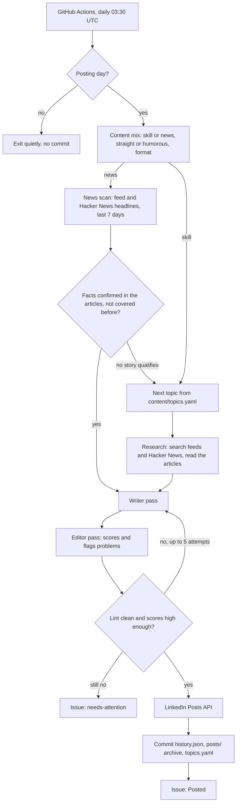

# LinkedIn AI Series Agent

A small Python agent that researches, writes, quality-checks and publishes a LinkedIn post
every 3 days on AI and the future of tech. It runs on GitHub Actions with no manual step, posts
through LinkedIn's official API, keeps a full record of everything it publishes, and runs at
$0 a month on free model tiers and free news sources.

The hard part isn't calling an API. It's getting posts that read like a person wrote them, with
facts that hold up, every time, unattended. Most of this repo is about that: research grounded
in real articles, a second "editor" model, deterministic checks that reject AI-sounding text,
retries with feedback, and clear alerts when something needs a human.

## What it does

Every day at 03:30 UTC (9:00 AM IST) a GitHub Actions run:

1. Checks whether it's a posting day (3+ days since the last post).
2. Picks the post type and tone: about 1 in 3 posts reacts to recent news, about 1 in 3 is
   dry or funny, never two of either in a row, and the format rotates so consecutive posts
   never share a shape.
3. Researches from free sources (RSS feeds of company blogs and tech press, plus Hacker News
   search): 1-2 recent developments for a skill topic, or one news story from the last 7 days.
   It fetches the articles and the model works only from their text, citing them by id. News
   needs 2 independent sources or 1 official one, and every key fact is checked.
4. Writes the post, has a separate "blunt editor" pass score it and flag every weak or
   unsupported sentence, and runs deterministic lint checks. The writer fixes what was flagged,
   up to 5 attempts. Only text the editor scored and lint passed can be posted.
5. Publishes through the LinkedIn Posts API, commits the updated history back to the repo, and
   opens a GitHub issue with the post, link, scores and sources.

If anything goes wrong it doesn't post. It opens a `needs-attention` issue instead, and GitHub
emails you.

## How it works



| Module | Job |
|---|---|
| `scheduler.py` | Is today a posting day? (date interval, so month boundaries just work) |
| `mix.py` | Post type, tone and format rotation |
| `topics.py` | Next topic; asks the model for 5 new ones when fewer than 3 are left, so the series never runs dry |
| `sources.py` | Free research sources: RSS/Atom feeds, Hacker News search, article text extraction |
| `research.py`, `news.py` | Pick developments and news from fetched articles; news is scored, de-duplicated and fact-checked |
| `llm.py` | One interface over OpenAI-compatible providers (Gemini, Groq) and Claude (direct or on Amazon Bedrock) |
| `writer.py`, `editor.py`, `generate.py` | Writer and editor passes and the retry loop |
| `lint.py` | Deterministic anti-AI checks (banned phrases, em dashes, "it's not X, it's Y", repeated openings, emoji, hashtags, length) |
| `linkedin.py` | LinkedIn Posts API client: escaping, retries, 401 handling |
| `notify.py` | GitHub issues: posted records, alerts, token reminders, review-window drafts |
| `main.py` | Orchestration and the command line |

Prompts live in `src/agent/prompts/` as Markdown, not inline strings. The writing rules live in
`content/style.md`, the only personal facts the agent may use live in `content/author.md`, and
the research sources live in `content/feeds.yaml`.

## Why the posts shouldn't read like AI

- **A style guide with teeth.** `content/style.md` sets the voice (plain, first person, real
  opinions, specific examples) and lists banned words and patterns.
- **Deterministic lint** (`lint.py`) rejects any post with a banned phrase, more than one em
  dash, "it's not X, it's Y" constructions, three sentences in a row starting with the same
  word, repeated lists of three, emoji bullets, more than one emoji or three hashtags, numbered
  "part N of M" posts, or an opening line shaped like one of the last 5 posts.
- **A second model as editor.** It scores "sounds like a real person" (needs 8/10), and for
  humorous posts "actually funny and still professional" (needs 7/10). It quotes every line that
  sounds generic or isn't backed by the research or author facts, and the writer fixes those
  lines. The post that goes out is always the exact text the editor scored.
- **Facts only from this run's articles.** The model sees only articles fetched in this run and
  cites them by id; the agent maps ids back to real URLs and feed dates, so a post can't cite a
  made-up source. Personal details come only from `content/author.md`.

## Setup

You need a GitHub account, a LinkedIn account, and a free API key from a model provider.

### 1. Get the code

Fork or clone this repository. Everything below happens in your copy.

### 2. Model API key (free)

The default provider is **Gemini**, on Google's free tier:

1. Sign in at [aistudio.google.com](https://aistudio.google.com) with a Google account.
2. Click **Get API key** and create one. No billing account is needed for the free tier.

Alternatives, set in `config.yaml` (`llm_provider` plus the three model names; examples are in
the comments there):

| Provider | Key variable | Cost |
|---|---|---|
| `gemini` (default) | `GEMINI_API_KEY` | Free tier, rate-limited |
| `groq` | `GROQ_API_KEY` | Free tier, rate-limited (tight tokens-per-minute; see comments in `config.yaml`) |
| `anthropic` | `ANTHROPIC_API_KEY` | Paid, prepaid credit at platform.claude.com |
| `bedrock` | `AWS_BEARER_TOKEN_BEDROCK` | Claude on Amazon Bedrock. Paid per token, but new AWS accounts get free credits |

#### Claude on Amazon Bedrock

Claude writes noticeably better posts than the free models, and AWS gives new accounts (opened
on or after 15 July 2025) up to $200 in credits that Bedrock can use. At this agent's volume
that covers months of posts. Bedrock has no free tier of its own, so once the credits run out it
costs a few dollars a month (see [Costs](#costs)).

1. Create an AWS account, ideally a personal one, since the bot posts to your own profile.
2. In the Amazon Bedrock console, open the model catalog and submit Anthropic's one-time
   **use case details** form. Claude requests fail until this is done.
3. In the Bedrock console, create an **API key** (give it an expiry date) and save it as the
   `AWS_BEARER_TOKEN_BEDROCK` secret.
4. In **AWS Budgets**, add a small monthly budget alert (say $5), so a bug can never run up a
   bill unnoticed.
5. In `config.yaml`:

   ```yaml
   llm_provider: bedrock
   writer_model: anthropic.claude-sonnet-5-5
   editor_model: anthropic.claude-sonnet-5-5
   research_model: anthropic.claude-sonnet-5-5
   fallback_model: anthropic.claude-sonnet-5   # tried once if Claude declines a request
   aws_region: us-east-1                       # the region your API key belongs to
   ```

6. Run the workflow with **check** ticked. Each model should show `available`; a `PROBLEM` line
   carries Bedrock's own message (a wrong model ID, the wrong region, or the form not submitted).

### 3. LinkedIn developer app

1. Create an app at [developer.linkedin.com](https://developer.linkedin.com). LinkedIn asks for a
   company page to associate it with; any page you admin works.
2. Under **Products**, add **Sign In with LinkedIn using OpenID Connect** and **Share on
   LinkedIn**.
3. Under **Auth**, add `http://localhost:8000/callback` as an authorized redirect URL, and note
   the Client ID and Client Secret.

### 4. Get a LinkedIn token (on your own computer)

This is the only step that needs Python on your machine (3.12 or newer), because it opens your
browser and listens on `localhost`.

```bash
python -m venv .venv && .venv/bin/pip install -e .
.venv/bin/python scripts/linkedin_auth.py
```

On Windows, in PowerShell from the repository folder (the leading `.\` matters):

```powershell
py -3.12 -m venv .venv
.\.venv\Scripts\python -m pip install -e .
.\.venv\Scripts\python scripts\linkedin_auth.py
```

If Windows Firewall asks whether Python may listen on the network, allow it on private networks;
the script needs port 8000 on your own machine for LinkedIn's redirect.

It asks for the Client ID and Secret (or reads `LINKEDIN_CLIENT_ID` / `LINKEDIN_CLIENT_SECRET`
from `.env`), opens LinkedIn's consent page, and prints your access token, person URN and the
token's expiry date.

### 5. GitHub secrets and variables

In your repository: **Settings > Secrets and variables > Actions**.

| Name | Kind | Value |
|---|---|---|
| `GEMINI_API_KEY` | Secret | Your Gemini key (or `GROQ_API_KEY` / `ANTHROPIC_API_KEY` / `AWS_BEARER_TOKEN_BEDROCK` for those providers) |
| `LINKEDIN_ACCESS_TOKEN` | Secret | From `linkedin_auth.py` |
| `LINKEDIN_PERSON_URN` | Secret | From `linkedin_auth.py`, like `urn:li:person:AbC123` |
| `LINKEDIN_TOKEN_EXPIRES_ON` | Variable | From `linkedin_auth.py`, like `2026-12-27` |

The workflow uses the built-in `GITHUB_TOKEN` for commits and issues; there's nothing to add for
that.

### 6. Check the setup and preview posts

Everything here runs from the browser: **Actions > Post to LinkedIn > Run workflow**.

1. Tick **check** and run it. The log confirms the API key works, the model names exist for your
   key, and which research feeds are reachable.
2. Tick **dry_run** and **force**, pick a **post_type** and **tone**, and run it. The log shows
   the post, the articles it used, editor scores and lint results. A dry run never posts, opens
   issues, commits, or changes `state/`, `content/` or `posts/`.

The same from a local checkout, with the key in `.env`:

```bash
.venv/bin/python -m agent.main --check
.venv/bin/python -m agent.main --dry-run --force --post-type news --tone humorous
```

### 7. Go live

Once the dry runs read well, the daily schedule takes over. See the
[go-live checklist](#go-live-checklist) below.

## Day to day

**Add topics.** Append to `content/topics.yaml` with a unique `id`, a `title`, an `angle` and
`status: pending`. Topics are used in file order. The agent adds its own (marked
`source: auto`) when fewer than 3 are pending; set `auto_extend_topics: false` to stop that.

**Change research sources.** Edit `content/feeds.yaml`: add RSS feeds you trust (mark company
blogs `official: true`), remove ones that go quiet, or change the Hacker News queries. The
**check** run shows which feeds load.

**Change the tone or mix.** In `config.yaml`: `news_post_ratio` and `humour_ratio` (default
0.33 each; 0 turns them off), `post_interval_days`, `min_editor_score`, `min_humour_score`. The
voice itself is in `content/style.md`.

**Switch model provider.** In `config.yaml`, change `llm_provider` and the three model names
(examples in the comments), and add that provider's key as a secret.

**Review before posting.** Set `review_window_hours` (for example `24`). Each post then waits as
a `scheduled` issue; close the issue or add the `reject` label to stop it, otherwise it's
published on the first run after the window. Default `0` publishes immediately.

**Run by hand.** **Actions > Post to LinkedIn > Run workflow**: `force` ignores the interval,
`topic_id` picks a topic, `post_type` and `tone` override the mix, `dry_run` writes without
publishing, `check` only checks the setup.

**Pause.** **Actions > Post to LinkedIn > ... > Disable workflow**.

**Refresh the LinkedIn token.** Member tokens last about 60 days and can't be refreshed
automatically. Seven days before `LINKEDIN_TOKEN_EXPIRES_ON` the agent opens a reminder issue
(one, updated daily, never duplicated). Re-run `scripts/linkedin_auth.py` and update the secret
and variable.

## Issues it opens

| Label | When |
|---|---|
| `posted` | Every published post: text, LinkedIn link, type, tone, format, editor scores, sources |
| `needs-attention` | Quality checks failed 5 times (with the best draft and reasons), the model API or LinkedIn failed, or the topic backlog couldn't be refilled. Nothing was posted. |
| `token-expiry` | The LinkedIn token expires within 7 days |
| `scheduled` | A draft waiting out the review window (only if `review_window_hours` > 0) |

## Costs

- **Model:** $0 on the Gemini or Groq free tier. A posting day makes roughly 5 to 14 model calls
  (research or news scan and check, then writer and editor, up to 5 rounds), well inside free
  limits. Every run logs its token use in the final `run.summary` line. With Claude instead
  (directly or on Bedrock), expect very roughly $1-3 a month at Sonnet prices, about $0.15-0.35
  per post. On a new AWS account the free credits cover that for months.
- **Research sources:** free. RSS feeds and the Hacker News search API need no keys.
- **LinkedIn API:** free.
- **GitHub Actions:** free for public repositories. Non-posting days finish in well under a
  minute.

## Limitations

- **Free tiers have limits and change.** Providers adjust free models and rate limits often; a
  model can be renamed or retired. The **check** run catches a missing model, and a failed run
  opens an issue. Popular free models are sometimes "overloaded": the agent retries, then
  switches to `fallback_model` (a lighter model) for the rest of that run. Google's terms let it use free-tier prompts and responses to improve its
  products; the posts are public anyway, but don't put anything private in the prompts.
- **Research is only as good as the feeds.** The agent sees what `content/feeds.yaml` and Hacker
  News surface. Feeds sometimes move or break (they're skipped, and **check** shows them).
  Paywalled articles fall back to the feed summary.
- **Strict news verification means some news days become skill days.** That's on purpose.
- **The LinkedIn token lasts about 60 days** and needs a manual refresh (the agent reminds you).
- **Text-only posts in v1.** `linkedin.py` has a `media_urn` hook for images later.
- **Rare double-post risk.** If LinkedIn returns a 5xx after actually creating a post, the retry
  can create a second one. And if the state commit fails after a post goes out, the next run
  could post again. The workflow retries the push and flags an error if it still fails.
- **GitHub's cron isn't exact.** Scheduled runs can start late when GitHub is busy.

## Project layout

```
config.yaml                 interval, model provider and names, word limits, mix ratios, flags
content/
  topics.yaml               topic backlog
  feeds.yaml                research sources: RSS feeds, official domains, Hacker News queries
  style.md                  the writing style guide
  author.md                 the only personal facts the agent may use
state/history.json          every post: date, type, topic or news story, format, tone, text, URN, sources
posts/                      archive: YYYY-MM-DD-<slug>.md per published post
src/agent/                  the agent (modules above) and prompts/
scripts/linkedin_auth.py    one-time local OAuth helper
tests/                      pytest; every model, feed, LinkedIn and GitHub call is mocked
.github/workflows/          post.yml (daily run) and tests.yml (lint + tests on every push)
```

## Development

```bash
pip install -e ".[dev]"
ruff check src tests scripts && ruff format --check src tests scripts
pytest -q
```

## Notes on API choices

These were checked against current documentation in October 2026 and differ from the original
brief in `CLAUDE.md` where noted.

- **Free model providers (change from the brief).** The brief specified the Claude API. To run
  at $0, the default is now Gemini's free tier through its OpenAI-compatible endpoint
  (`https://generativelanguage.googleapis.com/v1beta/openai/`), with Groq as a drop-in
  alternative. Claude is still supported (`llm_provider: anthropic`) through the official
  Anthropic SDK, with prompt caching and the server-side refusal fallback.
- **Claude on Amazon Bedrock.** `llm_provider: bedrock` uses the Anthropic SDK's Bedrock Mantle
  client (`AnthropicBedrockMantle`), which speaks the same Messages API, so effort, prompt
  caching and structured outputs work unchanged. It authenticates with a Bedrock API key
  (`AWS_BEARER_TOKEN_BEDROCK`), so no AWS SDK is needed. Bedrock doesn't offer the server-side
  refusal fallback, so a declined request is retried once on `fallback_model` instead. The
  **check** run tests each model with a token count, which is free.
- **Research from free sources (change from the brief).** The brief specified Anthropic's
  server-side web search. Web search isn't free on current Gemini or Groq models, so research now
  comes from RSS feeds and Hacker News search, and the agent fetches the articles itself. This
  also makes sourcing stricter: the model can only cite articles the agent actually fetched.
- **Up to 5 attempts (change from the brief, agreed October 2026).** The brief allows 3
  write, edit and lint rounds. With the open models on Bedrock, posts often came within one round of
  passing, so `max_attempts` is 5. A post that still fails isn't published.
- **Editor rewrites are never posted (change from the brief, agreed October 2026).** The brief
  has the editor return a rewritten version. In practice nothing checked that rewrite after it
  was written, and editors slipped invented stories and wrong facts into it. The editor still
  returns a rewrite (kept for reference), but the writer fixes the flagged sentences, and only a
  version the editor scored and lint passed can be posted.
- **JSON replies.** OpenAI-compatible providers get the JSON schema as an instruction and the
  reply is parsed forgivingly (with one retry on bad JSON); Claude uses native structured
  outputs.
- **LinkedIn API version.** The Posts API is called with `LinkedIn-Version: 202610`, the newest
  version as of October 2026; LinkedIn supports each version for at least a year.
- **LinkedIn text escaping.** Post text is escaped per LinkedIn's "little text format" (every
  one of `| { } @ [ ] ( ) < > # \ * _ ~` gets a backslash), and hashtags are sent as
  `{hashtag|\#|Tag}` templates so they still render as hashtags.

## Go-live checklist

- [ ] Model API key for `llm_provider` saved as its secret (Gemini: `GEMINI_API_KEY`; Bedrock:
      `AWS_BEARER_TOKEN_BEDROCK`). If the key has an expiry date, put a reminder before it.
- [ ] **Run workflow** with **check** ticked: the log ends with `All good.` If a model shows
      `NOT FOUND`, use one from the listed available models in `config.yaml` (on Claude
      providers a `PROBLEM` line carries the API's own reason).
- [ ] Dry runs read well for all four kinds of post (pick them with **post_type** and **tone**):
      straight skill, humorous skill, straight news, sarcastic news. If the voice is off, edit
      `content/style.md`, not the code.
- [ ] LinkedIn app created with both products and the `http://localhost:8000/callback` redirect.
- [ ] `scripts/linkedin_auth.py` run; `LINKEDIN_ACCESS_TOKEN` and `LINKEDIN_PERSON_URN` saved as
      secrets, `LINKEDIN_TOKEN_EXPIRES_ON` saved as a variable.
- [ ] **Settings > Actions > General**: Actions allowed. If the "Commit state" step later fails
      with a permissions error, set **Workflow permissions** to **Read and write**.
- [ ] **Actions > Tests** is green on the latest commit.
- [ ] Decide on a review window. `review_window_hours: 24` for the first week is a safe start;
      set it back to `0` for fully automatic posting.
- [ ] First real post: run the workflow with only `force` ticked, or wait for 03:30 UTC.
- [ ] Check it: the post looks right on LinkedIn (hashtags clickable, no stray backslashes), a
      `Posted:` issue was opened, and a `chore: post <slug>` commit landed on the default branch.
- [ ] Make sure GitHub emails you about issues (watch the repository) so alerts reach you.
- [ ] Put a calendar reminder about 50 days out to refresh the LinkedIn token, as a backup to the
      reminder issue.

-- Ashish
