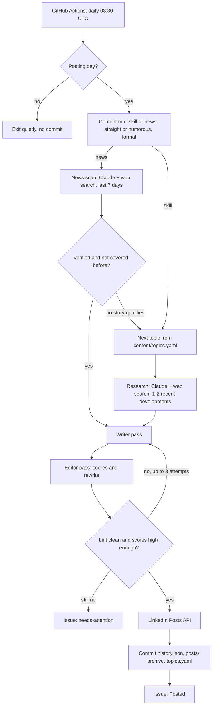

# LinkedIn AI Series Agent

A small Python agent that researches, writes, quality-checks and publishes a LinkedIn post
every 3 days on AI and the future of tech. It runs on GitHub Actions with no manual step, posts
through LinkedIn's official API, and keeps a full record of everything it publishes.

The hard part isn't calling an API. It's getting posts that read like a person wrote them, with
facts that hold up, every time, unattended. Most of this repo is about that: research with real
sources, a second "editor" model, deterministic checks that reject AI-sounding text, retries
with feedback, and clear alerts when something needs a human.

## What it does

Every day at 03:30 UTC (9:00 AM IST) a GitHub Actions run:

1. Checks whether it's a posting day (3+ days since the last post).
2. Picks the post type and tone: about 1 in 3 posts reacts to recent news, about 1 in 3 is
   dry or funny, never two of either in a row, and the format rotates so consecutive posts
   never share a shape.
3. Researches with Claude and web search: 1-2 recent developments for a skill topic, or one
   verified news story from the last 7 days (2 independent sources or 1 official source).
4. Writes the post, has a separate "blunt editor" pass score and rewrite it, and runs
   deterministic lint checks. Up to 3 attempts, each one fed the previous failures.
5. Publishes through the LinkedIn Posts API, commits the updated history back to the repo, and
   opens a GitHub issue with the post, link, scores and sources.

If anything goes wrong it doesn't post. It opens a `needs-attention` issue instead, and GitHub
emails you.

## How it works



| Module | Job |
|---|---|
| `scheduler.py` | Is today a posting day? (date interval, so month boundaries just work) |
| `mix.py` | Post type, tone and format rotation |
| `topics.py` | Next topic; asks Claude for 5 new ones when fewer than 3 are left, so the series never runs dry |
| `research.py`, `news.py` | Claude with server-side web search; news is scored, de-duplicated and fact-checked |
| `writer.py`, `editor.py`, `generate.py` | Writer and editor passes and the retry loop |
| `lint.py` | Deterministic anti-AI checks (banned phrases, em dashes, "it's not X, it's Y", repeated openings, emoji, hashtags, length) |
| `linkedin.py` | LinkedIn Posts API client: escaping, retries, 401 handling |
| `notify.py` | GitHub issues: posted records, alerts, token reminders, review-window drafts |
| `main.py` | Orchestration and the command line |

Prompts live in `src/agent/prompts/` as Markdown, not inline strings. The writing rules live in
`content/style.md` and the only personal facts the agent may use live in `content/author.md`.
Both are included in every writer and editor prompt.

## Why the posts shouldn't read like AI

- **A style guide with teeth.** `content/style.md` sets the voice (plain, first person, real
  opinions, specific examples) and lists banned words and patterns.
- **Deterministic lint** (`lint.py`) rejects any post with a banned phrase, more than one em
  dash, "it's not X, it's Y" constructions, three sentences in a row starting with the same
  word, repeated lists of three, emoji bullets, more than one emoji or three hashtags, numbered
  "part N of M" posts, or an opening line shaped like one of the last 5 posts.
- **A second model as editor.** It scores "sounds like a real person" (needs 8/10), and for
  humorous posts "actually funny and still professional" (needs 7/10). It quotes every line that
  sounds generic and rewrites the post.
- **Facts only from this run's research.** Recent claims must come from web search results with
  sources; personal details only from `content/author.md`; no invented numbers.

## Setup

You need a GitHub account, a LinkedIn account, and an Anthropic API account with credit.

### 1. Get the code

Fork or clone this repository. Everything below happens in your copy.

### 2. Claude API key

1. Sign in at [platform.claude.com](https://platform.claude.com) (formerly console.anthropic.com).
2. Add credit under **Billing**. API usage is billed separately from a Claude.ai subscription.
3. Create a key under **Settings > API Keys**. Copy it: it's shown once.

### 3. LinkedIn developer app

1. Create an app at [developer.linkedin.com](https://developer.linkedin.com). LinkedIn asks for a
   company page to associate it with; any page you admin works.
2. Under **Products**, add **Sign In with LinkedIn using OpenID Connect** and **Share on
   LinkedIn**.
3. Under **Auth**, add `http://localhost:8000/callback` as an authorized redirect URL, and note
   the Client ID and Client Secret.

### 4. Get a LinkedIn token (on your own computer)

```bash
python -m venv .venv && .venv/bin/pip install -e ".[dev]"      # Windows: .venv\Scripts\python -m pip ...
.venv/bin/python scripts/linkedin_auth.py
```

It asks for the Client ID and Secret (or reads `LINKEDIN_CLIENT_ID` / `LINKEDIN_CLIENT_SECRET`
from `.env`), opens LinkedIn's consent page, and prints your access token, person URN and the
token's expiry date.

### 5. GitHub secrets and variables

In your repository: **Settings > Secrets and variables > Actions**.

| Name | Kind | Value |
|---|---|---|
| `ANTHROPIC_API_KEY` | Secret | Your Claude API key |
| `LINKEDIN_ACCESS_TOKEN` | Secret | From `linkedin_auth.py` |
| `LINKEDIN_PERSON_URN` | Secret | From `linkedin_auth.py`, like `urn:li:person:AbC123` |
| `LINKEDIN_TOKEN_EXPIRES_ON` | Variable | From `linkedin_auth.py`, like `2026-12-27` |

The workflow uses the built-in `GITHUB_TOKEN` for commits and issues; there's nothing to add for
that.

### 6. First dry run

Locally, with `ANTHROPIC_API_KEY` in `.env`:

```bash
.venv/bin/python -m agent.main --dry-run --force
.venv/bin/python -m agent.main --dry-run --force --post-type news --tone humorous
```

Or on GitHub: **Actions > Post to LinkedIn > Run workflow**, tick **dry_run** and **force**.
A dry run prints the post, the research it used, editor scores, lint results and the estimated
cost. It never posts, opens issues, commits, or changes `state/`, `content/` or `posts/`.

### 7. Go live

Once the dry runs read well, the daily schedule takes over. See the
[go-live checklist](#go-live-checklist) below.

## Day to day

**Add topics.** Append to `content/topics.yaml` with a unique `id`, a `title`, an `angle` and
`status: pending`. Topics are used in file order. The agent adds its own (marked
`source: auto`) when fewer than 3 are pending; set `auto_extend_topics: false` to stop that.

**Change the tone or mix.** In `config.yaml`: `news_post_ratio` and `humour_ratio` (default
0.33 each; 0 turns them off), `post_interval_days`, `min_editor_score`, `min_humour_score`. The
voice itself is in `content/style.md`.

**Review before posting.** Set `review_window_hours` (for example `24`). Each post then waits as
a `scheduled` issue; close the issue or add the `reject` label to stop it, otherwise it's
published on the first run after the window. Default `0` publishes immediately.

**Run by hand.** **Actions > Post to LinkedIn > Run workflow**: `force` ignores the interval,
`topic_id` picks a topic, `dry_run` writes without publishing.

**Pause.** **Actions > Post to LinkedIn > ... > Disable workflow**.

**Refresh the LinkedIn token.** Member tokens last about 60 days and can't be refreshed
automatically. Seven days before `LINKEDIN_TOKEN_EXPIRES_ON` the agent opens a reminder issue
(one, updated daily, never duplicated). Re-run `scripts/linkedin_auth.py` and update the secret
and variable.

## Issues it opens

| Label | When |
|---|---|
| `posted` | Every published post: text, LinkedIn link, type, tone, format, editor scores, sources |
| `needs-attention` | Quality checks failed 3 times (with the best draft and reasons), LinkedIn rejected the post or the token, or the topic backlog couldn't be refilled. Nothing was posted. |
| `token-expiry` | The LinkedIn token expires within 7 days |
| `scheduled` | A draft waiting out the review window (only if `review_window_hours` > 0) |

## Costs

- **Claude API:** each post makes a handful of calls (research or news scan with web search,
  then writer and editor). Rough estimate from published prices (Claude Sonnet 5.5 at $2/$10
  per million input/output tokens, web search at $10 per 1,000 searches): about $0.05-0.30 per
  post, or roughly $1-3 a month at one post every 3 days. Every run logs its actual token use and
  estimated cost in the final `run.summary` line. On skill days the agent also checks whether a
  major story should jump the queue, an extra search; `big_news_check: false` turns that off.
- **LinkedIn API:** free.
- **GitHub Actions:** free for public repositories. Non-posting days finish in well under a
  minute.

## Limitations

- **The LinkedIn token lasts about 60 days** and needs a manual refresh (the agent reminds you).
- **Text-only posts in v1.** `linkedin.py` has a `media_urn` hook for images later.
- **Strict news verification means some news days become skill days.** That's on purpose.
- **Rare double-post risk.** If LinkedIn returns a 5xx after actually creating a post, the retry
  can create a second one. And if the state commit fails after a post goes out, the next run
  could post again. The workflow retries the push and flags an error if it still fails.
- **GitHub's cron isn't exact.** Scheduled runs can start late when GitHub is busy.

## Project layout

```
config.yaml                 interval, models, word limits, mix ratios, flags
content/
  topics.yaml               topic backlog
  style.md                  the writing style guide
  author.md                 the only personal facts the agent may use
state/history.json          every post: date, type, topic or news story, format, tone, text, URN, sources
posts/                      archive: YYYY-MM-DD-<slug>.md per published post
src/agent/                  the agent (modules above) and prompts/
scripts/linkedin_auth.py    one-time local OAuth helper
tests/                      pytest; Claude, LinkedIn and GitHub are all mocked
.github/workflows/          post.yml (daily run) and tests.yml (lint + tests on every push)
```

## Development

```bash
pip install -e ".[dev]"
ruff check src tests scripts && ruff format --check src tests scripts
pytest -q
```

## Notes on API choices

These were checked against current docs in October 2026 and differ from older examples online.

- **Claude models and web search.** Writer, editor and research use `claude-sonnet-5-5`
  (configurable in `config.yaml`). Web search uses `web_search_20260318`, the current version in
  the Anthropic docs (it adds `response_inclusion` on top of the dynamic filtering in
  `web_search_20260209`).
- **JSON from research calls.** Research and news calls ask for JSON inside `<result>` tags
  instead of using structured outputs: web search always returns citations, and the docs list
  citations as incompatible with `output_config.format`. Calls without web search (editor, topic
  proposals) use structured outputs.
- **Refusal fallback.** Requests opt into Anthropic's server-side `fallbacks: "default"` so a
  rare safety-classifier decline is retried on another model (`refusal_fallback` in config).
- **LinkedIn API version.** The Posts API is called with `LinkedIn-Version: 202610`, the newest
  version as of October 2026; LinkedIn supports each version for at least a year.
- **LinkedIn text escaping.** Post text is escaped per LinkedIn's "little text format" (every
  one of `| { } @ [ ] ( ) < > # \ * _ ~` gets a backslash), and hashtags are sent as
  `{hashtag|\#|Tag}` templates so they still render as hashtags.

## Go-live checklist

- [ ] Claude API key created, credit added, and `ANTHROPIC_API_KEY` saved as a repository secret.
      Optionally set a monthly spend limit in the Console.
- [ ] Local dry runs read well for all four kinds of post: straight skill, humorous skill,
      straight news, sarcastic news. If the voice is off, edit `content/style.md`, not the code.
- [ ] LinkedIn app created with both products and the `http://localhost:8000/callback` redirect.
- [ ] `scripts/linkedin_auth.py` run; `LINKEDIN_ACCESS_TOKEN` and `LINKEDIN_PERSON_URN` saved as
      secrets, `LINKEDIN_TOKEN_EXPIRES_ON` saved as a variable.
- [ ] **Settings > Actions > General**: Actions allowed. If the "Commit state" step later fails
      with a permissions error, set **Workflow permissions** to **Read and write**.
- [ ] **Actions > Tests** is green on the latest commit.
- [ ] **Actions > Post to LinkedIn > Run workflow** with `dry_run` and `force` ticked: the log
      ends with `run.summary status=dry_run_ok`.
- [ ] Decide on a review window. `review_window_hours: 24` for the first week is a safe start;
      set it back to `0` for fully automatic posting.
- [ ] First real post: run the workflow with only `force` ticked, or wait for 03:30 UTC.
- [ ] Check it: the post looks right on LinkedIn (hashtags clickable, no stray backslashes), a
      `Posted:` issue was opened, and a `chore: post <slug>` commit landed on the default branch.
- [ ] Make sure GitHub emails you about issues (watch the repository) so alerts reach you.
- [ ] Put a calendar reminder about 50 days out to refresh the LinkedIn token, as a backup to the
      reminder issue.

-- Ashish
